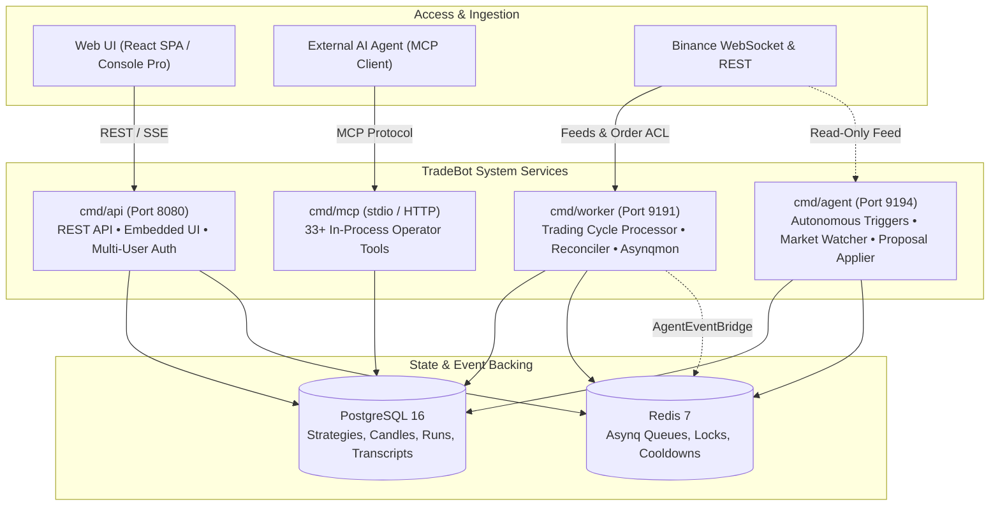

<div align="center">

<p align="center">
  
</p>

# ⚡ Go Binance Trade Bot

**An enterprise-grade, autonomous algorithmic trading platform and AI strategy co-pilot for Binance.**

<p align="center">
  <a href="https://demitriusquadros.github.io/go-trade-bot/"></a>
  <a href="https://golang.org"></a>
  <a href="web/"></a>
  <a href="docker-compose.yml"></a>
  <a href="docker-compose.yml"></a>
  <a href="cmd/mcp/"></a>
  <a href="docker-compose.yml"></a>
  <a href="LICENSE"></a>
</p>

> 🌐 **Official Documentation:** Visit **[https://demitriusquadros.github.io/go-trade-bot/](https://demitriusquadros.github.io/go-trade-bot/)** for complete guides, architectural deep dives, Lua indicator references, and tutorials in **English**, **Português**, and **Español**.

---

[Key Features](#-key-features) • [System Architecture](#-system-architecture) • [Quick Start](#-quick-start) • [Execution & Safety](#-execution-modes--safety-invariants) • [Lua Strategy Engine](#-lua-strategy-engine) • [Agents & MCP](#-autonomous-agents--mcp-copilot) • [Web Control Plane](#-web-control-plane) • [Documentation](#-documentation-directory)

</div>

---

## 📖 Overview

**Go Binance Trade Bot** is an institutional-grade, distributed algorithmic trading platform written in Go. Engineered for spot cryptocurrency markets on Binance, it bridges high-performance quantitative trading engines with state-of-the-art **Autonomous AI Agents** and **Model Context Protocol (MCP)** integration.

From sandboxed **Lua script execution** backed by 60+ technical indicators to **asynchronous walk-forward backtesting**, automated **challenger vs. champion deployment gates**, and an embedded **Console Pro web interface**, TradeBot delivers a resilient, auditable, and self-improving trading operations platform.

---

## ✨ Key Features

| Capability | Description |
| :--- | :--- |
| **🛡️ Dual-Layer Safety Guard** | Strict multi-stage execution controls with `MODE` process ceiling, `CONFIRM_LIVE=true` assertions, real exchange-side stop-market orders, and automated daily loss limits ($ USD). |
| **📜 Sandboxed Lua Scripting** | High-performance `gopher-lua` runtime with hot-reloading, state persistence across worker replicas, cycle execution tracing, and instant REPL prototyping. |
| **📈 60+ Technical Indicators** | Built-in TA-Lib integration accessible directly within Lua scripts (`ind.rsi`, `ind.bollinger`, `ind.macd`, `ind.adx`, `ind.stoch`, `ind.atr`, and more). |
| **🤖 Autonomous AI Agents** | Configurable AI agents (Claude & Gemini) that observe market volatility, track drawdown events, test optimizations, and author data-driven strategy proposals. |
| **🚪 Deploy Gate & Challengers** | Safe strategy iteration: agents fork live champions into paper-trading challengers until passing walk-forward gates and receiving explicit operator approval. |
| **🔌 Native MCP Server** | 33+ in-process tools for AI coding assistants (Claude Desktop, Cursor, Antigravity) to audit backtests, launch optimizations, query candles, and inspect live risk. |
| **🔄 Self-Healing Candle Reconciler** | Automated multi-timeframe dataset synchronization against Binance archive zips and REST fallback with zero-downtime ledger coverage. |
| **🖥️ Console Pro Web UI** | Modern embedded React 18 / Tailwind / Lightweight-Charts dashboard with multi-user RBAC, Cloudflare Access JWT validation, and real-time SSE streaming. |

---

## 🏛️ System Architecture

TradeBot is built with **Uber FX** dependency injection across four specialized, decoupled services sharing core domain and infrastructure packages:



### Process Roles
* **`cmd/api`**: REST API server (`gorilla/mux`) on port 8080. Handles session authentication (CSRF, cookies, Cloudflare Access), RBAC capabilities, strategy CRUD, and serves the embedded Single Page Application (`go:embed`).
* **`cmd/worker`**: Asynq background processor on port 9191. Executes trading strategy cycles, evaluates simulated and exchange stops, enforces daily loss limits, and reconciles candle dataset chunks.
* **`cmd/agent`**: Isolated agents platform runtime on port 9194. Consumes the `agents` queue, monitors market volatility rules, and executes LLM agent loops using a **strictly read-only exchange adapter**.
* **`cmd/mcp`**: High-performance MCP server exposing 33 operator tools directly in-process without intermediate HTTP hops or network overhead.

---

## 🚀 Quick Start

### 1. Prerequisites
* **Docker & Docker Compose** (Recommended) or **Go 1.25+** with **Node.js 20+**
* Binance API credentials (Spot or Testnet)

### 2. Run with Docker Compose
Clone the repository and spin up the complete stack:

```bash
# 1. Clone repository
git clone https://github.com/DemitriusQuadros/go-trade-bot.git
cd go-trade-bot

# 2. Configure environment credentials
cp config.example.yml config.yml

# 3. Start PostgreSQL, Redis, Prometheus, Grafana, Alertmanager & TradeBot services
make up
```

Access the web interface and monitoring tools:
* 🌐 **Web Control Plane**: [http://localhost:8080](http://localhost:8080)
* 📊 **Trading Worker Asynqmon**: [http://localhost:9191/tasks/monitoring](http://localhost:9191/tasks/monitoring)
* 🤖 **Agent Runtime Asynqmon**: [http://localhost:9194/tasks/monitoring](http://localhost:9194/tasks/monitoring)
* 📈 **Grafana Dashboards**: [http://localhost:3000](http://localhost:3000) (admin / admin)
* 🔍 **Prometheus Metrics**: [http://localhost:9090](http://localhost:9090)

### 3. Local Bare-Metal Development

```bash
# Download Go dependencies
go mod download

# Run local API server (serves web UI on port 8080)
make run-api-local

# In separate terminals:
make run-worker-local
make run-agent-local

# Run Vite frontend dev server with Hot Module Reloading
make web-dev
```

---

## 🛡️ Execution Modes & Safety Invariants

Because TradeBot executes real financial transactions, safety is enforced at the architectural level:

```
┌─────────────────────────────────────────────────────────────┐
│                      DUAL-LAYER GUARD                       │
├──────────────────────────────┬──────────────────────────────┤
│ Strategy.Mode ("dryrun")     │ System ENV MODE ("dryrun")   │
│   • live                     │   • live                     │
│   • paper                    │   • paper                    │
│   • dryrun                   │   • dryrun                   │
│   • backtest                 │   • backtest                 │
└──────────────────────────────┴──────────────────────────────┘
```

1. **Dual-Layer Gate**: A strategy configured with `mode: live` will **refuse to run** unless the process-level `MODE=live` AND `CONFIRM_LIVE=true` environment flags are explicitly present. The system fails closed.
2. **Real Exchange Stops**: Live orders submit native exchange-side `STOP_MARKET` orders immediately upon position entry. Protection does not rely on local polling.
3. **Daily Loss Limit (R-01)**: Strategies configured with `max_daily_loss_usd` automatically halt new entries once cumulative realized losses since 00:00 UTC hit the defined limit.
4. **Agent Read-Only Sandbox**: `cmd/agent` is compiled exclusively with `exchange.ReadOnlyClient`. Agents have zero technical capability to submit orders, withdraw funds, or access exchange secrets.
5. **Challenger Deploy Gate**: An AI agent cannot directly edit a live strategy's code. Improvements fork into paper-trading **challengers**, must pass automated walk-forward gates, and require manual operator approval.

---

## 📜 Lua Strategy Engine

All strategies are written in standard Lua and executed inside a secure `gopher-lua` sandbox. Scripts access multi-timeframe candles, call indicators, store cycle state, and return order actions.

### Minimal Lua Strategy Example
```lua
-- Simple RSI Mean Reversion Strategy
function init(ctx)
    ctx:set_cycle_interval("15m")
end

function go_long(ctx)
    -- Calculate 14-period RSI using built-in TA-Lib bridge
    local rsi_values = ind.rsi(ctx.candles, 14)
    local current_rsi = rsi_values[#rsi_values]

    -- Check oversold condition
    if current_rsi < 30 then
        return {
            action = "buy",
            qty = 0.01,
            stop_loss = { price = ctx.price * 0.98 },
            take_profit = { price = ctx.price * 1.05 }
        }
    end
    return nil
end

function update_position(ctx)
    local rsi_values = ind.rsi(ctx.candles, 14)
    local current_rsi = rsi_values[#rsi_values]

    -- Exit position when RSI normalizes above 70
    if current_rsi > 70 then
        return { action = "sell", reason = "rsi_overbought" }
    end
    return nil
end
```

### Available Indicators (`ind.*`)
* **Trend & Overlap**: `ind.sma`, `ind.ema`, `ind.wma`, `ind.dema`, `ind.kama`, `ind.mama`, `ind.t3`
* **Momentum**: `ind.rsi`, `ind.macd`, `ind.stoch`, `ind.stochf`, `ind.adx`, `ind.cci`, `ind.mfi`, `ind.willr`
* **Volatility**: `ind.bollinger`, `ind.atr`, `ind.natr`, `ind.trange`
* **Volume**: `ind.obv`, `ind.ad`, `ind.adosc`
* **Candlestick Patterns**: Over 60 recognized candlestick formations.

---

## 🤖 Autonomous Agents & MCP Copilot

TradeBot features an autonomous multi-persona agent platform that continuously monitors and improves strategies:

```
[ Market Events / Crons / Drawdowns ] 
                  │
                  ▼
          [ Trigger Dispatch ] ──(Rate Limit & Cooldown)──► [ Agent Runtime ]
                                                                     │
   ┌─────────────────────────────────────────────────────────────────┘
   ▼
[ Sandboxed Tool Loop ]
   ├── `get_candle_coverage`  (Verify data depth before backtesting)
   ├── `run_backtest`          (Execute asynchronous simulations)
   ├── `create_challenger`     (Fork productive champion to paper test)
   ├── `deploy_to_testing`     (Walk-forward Sharpe/Drawdown gate check)
   └── `write_report`          (Generate rich HTML performance audits)
```

### Model Context Protocol (MCP) Integration
TradeBot exposes 33 in-process tools to external LLM clients (Claude Desktop, Cursor, Antigravity) via `cmd/mcp`:
* **Strategy Inspection**: `get_strategy`, `script_repl`, `script_fast_rerun`, `list_strategies`
* **Backtesting & Opt**: `run_backtest`, `get_backtest`, `run_walk_forward`, `run_monte_carlo`
* **Operations**: `get_open_positions`, `get_candle_coverage`, `get_scheduler_health`, `list_proposals`
* **Reports**: `get_agent_report_url`, `get_backtest_report_url`, `write_journal`

---

## 🖥️ Web Control Plane

The frontend is an embedded Single Page Application accessible directly from `cmd/api`:
* **Dual-Mode Layout (`Ctrl+Shift+.`)**: Toggle between **Agent Mode** (full-screen LLM copilot, strategy memory, and report inspector) and **Code Mode** (strategy IDE, REPL, backtest launcher, and live dashboard).
* **Console Pro UI**: Dark-mode terminal aesthetics built with Tailwind CSS, Lucide icons, and Lightweight-Charts.
* **Internationalization (i18n)**: Native localization for **English (`en`)**, **Português (`pt-BR`)**, and **Español (`es`)**.
* **Zero-Trust Security**: Native Cloudflare Access JWT validation, HttpOnly session cookies, and strict CSRF protection.

---

## 🧪 Testing & Quality Assurance

TradeBot maintains strict test coverage across unit, integration, and real-stack E2E suites:

```bash
# Run unit and integration tests
go test ./internal/... ./app/...

# Run race condition checks on concurrent engines
go test -race ./app/engine/... ./app/usecase/strategy/...

# Run real-stack Godog E2E test suite (SQLite, real handlers, MCP client)
go test -v ./tests/e2e/real/

# Verify web frontend build and i18n key consistency
cd web && npm test && npm run build
```

---

## 📚 Documentation Directory

Complete documentation is hosted live at **[demitriusquadros.github.io/go-trade-bot](https://demitriusquadros.github.io/go-trade-bot/)**.

| Topic | Description | Link |
| :--- | :--- | :--- |
| **System Architecture** | Decoupled 4-binary architecture and data flows | [Read Architecture](https://demitriusquadros.github.io/go-trade-bot/architecture/overview/) |
| **Safety Invariants** | Dual-layer guards, daily loss limit, read-only boundaries | [Read Safety](https://demitriusquadros.github.io/go-trade-bot/architecture/safety-invariants/) |
| **Data Pipeline & Reconciler** | Coverage ledgers, chunk management, archive zips | [Read Data Pipeline](https://demitriusquadros.github.io/go-trade-bot/architecture/data-pipeline/) |
| **Execution Modes** | Live vs. Paper vs. Dry-run vs. Backtest | [Read Execution Modes](https://demitriusquadros.github.io/go-trade-bot/trading/execution-modes/) |
| **Lua Strategy Scripting** | Hooks, state persistence, cycle execution, and indicators | [Read Scripting Guide](https://demitriusquadros.github.io/go-trade-bot/trading/lua-scripting/) |
| **Risk Management** | Stop-loss orders, daily loss limits (R-01), position sizing | [Read Risk Management](https://demitriusquadros.github.io/go-trade-bot/trading/risk-management/) |
| **Agents Platform** | Triggers, persona configuration, and shared memory | [Read Agents Platform](https://demitriusquadros.github.io/go-trade-bot/agents/platform/) |
| **Deploy Gate & Challengers** | Walk-forward gating, challenger testing, and proposals | [Read Deploy Gate](https://demitriusquadros.github.io/go-trade-bot/agents/deploy-gate/) |
| **MCP Operator Tools** | 33+ in-process tools for AI coding assistants | [Read MCP Reference](https://demitriusquadros.github.io/go-trade-bot/agents/mcp-server/) |
| **Docker Compose Guide** | Production container deployment and setup | [Read Docker Guide](https://demitriusquadros.github.io/go-trade-bot/guides/quickstart-docker/) |
| **Cloudflare Production** | Zero-trust tunnel, multi-user auth, and session RBAC | [Read Cloudflare Guide](https://demitriusquadros.github.io/go-trade-bot/guides/cloudflare-production/) |
| **REST API Reference** | Endpoints, capabilities, SSE streaming, and auth | [Read REST Reference](https://demitriusquadros.github.io/go-trade-bot/api/rest-reference/) |

---

## 📄 License

This project is licensed under the **MIT License** — see the [LICENSE](LICENSE) file for details. Built with ❤️ for autonomous quantitative trading.
