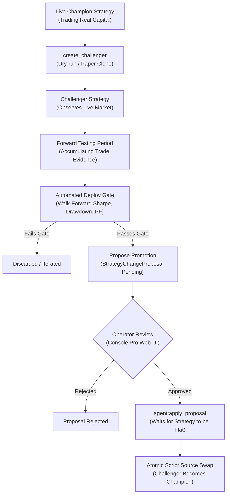

# Deploy Gate & Challenger Lifecycle

Allowing an AI model to modify a live trading strategy directly introduces catastrophic risk. TradeBot solves this through a rigorous **Champion vs. Challenger** architecture with automated walk-forward gates.

---

## 1. The Strategy Evolution Lifecycle

---

## 2. Automated Deploy Gate (`DeployGateConfig`)

Before any candidate strategy script can be submitted for promotion to live status, the Go engine subjects it to backtested walk-forward validation against the existing champion:

| Gate Parameter | Default | Purpose |
| :--- | :--- | :--- |
| `min_trades` | `20` | Guarantees statistical significance. |
| `min_sharpe_delta` | `0.0` | Candidate Sharpe ratio must meet or beat the baseline. |
| `max_dd_ratio` | `1.10` | Candidate maximum drawdown cannot exceed $1.10\times$ baseline. |
| `min_profit_factor` | `1.0` | Candidate must be net profitable. |
| `lookback_months` | `6` | Length of historical dataset evaluated. |
| `min_candle_coverage` | `90%` | Ensures dataset is complete without missing history. |

### Deterministic Calculation:
Deploy gate checks are **never calculated by the LLM**. The Go backend runs walk-forward simulations over identical candle windows, extracts quantitative performance metrics, and evaluates the mathematical inequalities deterministically.

---

## 3. Challenger Forward Testing

Passing a backtest is necessary, but insufficient. Overfitting to past data is the most common reason algorithmic strategies fail in production.

* **Challenger Clones**: When an agent tests an idea, it calls `create_challenger`, cloning the champion into a dryrun/paper-trading instance.
* **Forward Evidence**: The challenger runs in real time against live market feeds. When proposing promotion, the agent must present forward-test performance metrics accumulated since creation.

---

## 4. Operator Approval & Atomic Apply

Even after passing all automated gates, **no code is deployed to live trading without human authorization**:

1. **Review**: The human operator reviews the proposal diff, gate metrics, and forward-test evidence in the Console Pro web interface (`/proposals`).
2. **Approve / Reject**: The operator approves or rejects the change with an optional note (`POST /api/proposals/{id}/approve`).
3. **Flatness Check**: The apply task (`agent:apply_proposal`) verifies that the live strategy has zero open positions (`ctx.position == nil`). If a position is active, apply waits safely until the trade closes.
4. **Atomic Swap**: The script source is updated in a single database transaction under the Redis strategy cycle lock (`strategy-cycle:<id>`), clearing cached state and recording a new `ScriptVersion`.
