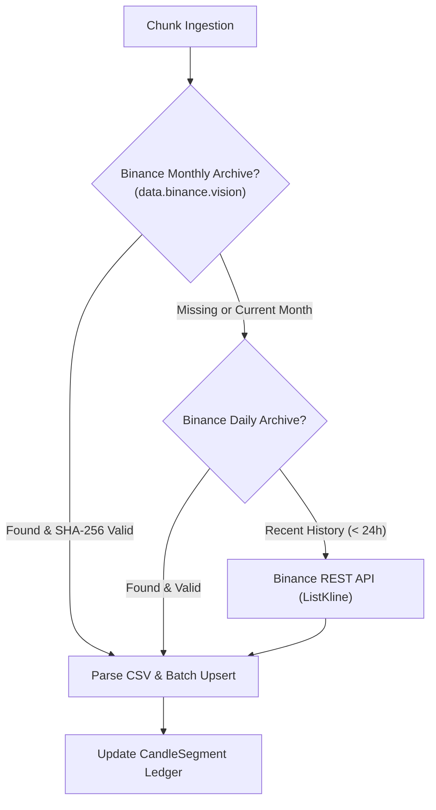

# Data Pipeline & Candle Reconciler

Accurate backtesting, walk-forward validation, and live strategy execution require clean, contiguous, gap-free historical OHLCV candle data.

TradeBot implements an automated **Candle Dataset Reconciler** that continuously aligns stored database records with authoritative exchange archives.

---

## 1. Reconciler Architecture

Instead of one-off, manually scheduled imports, TradeBot operates on a declarative **desired state** model:

```
[ User declares CandleDataset: BTCUSDT 15m, keep_live=true ]
                             │
                             ▼
               [ Coverage Ledger & Planner ]
                             │
        ┌────────────────────┴────────────────────┐
        ▼                                         ▼
[ Gap: 2023-01 to 2023-06 ]               [ Live Gap: Last 4 Hours ]
        │                                         │
        ▼                                         ▼
[ Chunks: Archive Monthly ]              [ Chunks: REST Fallback ]
        │                                         │
        └────────────────────┬────────────────────┘
                             ▼
         [ Batch Upsert & Ledger Update ]
```

### Core Primitives:
* **`CandleDataset`**: Declares a symbol, timeframe, optional retention start, and whether live updates should be maintained continuously (`keep_live: true`).
* **`CandleSegment` (Coverage Ledger)**: Tracks verified contiguous ranges (`loaded` or `known_gap`) along with source identifiers and archive SHA-256 checksums.
* **`CandleChunk`**: Subdivides required backfills into month-bounded, independently retryable Asynq tasks (`candledata:chunk`).

---

## 2. Multi-Tier Source Fallback Chain

When reconciling a missing candle chunk, the worker evaluates an authoritative source chain:



1. **Monthly Archives (`archive_monthly`)**: High-throughput zipped CSVs downloaded from Binance's public data repository. Verified against official SHA-256 checksums.
2. **Daily Archives (`archive_daily`)**: Used to fill recent days within the active month.
3. **REST API Fallback (`rest`)**: Fetches recent candles and live gaps via Binance REST kline endpoints. REST is the only authoritative source that can certify an exchange downtime gap as a verified `known_gap`.

---

## 3. Rate-Limiting & Batch Optimization

* **Redis Fixed-Window Rate Limiter**: Shared across worker replicas (`CANDLE_DATA.WEIGHT_BUDGET` default 3,000/min). If an HTTP 429/418 is encountered, a distributed backoff lock trips automatically across all processes.
* **Batch Insertion**: PostgreSQL has a maximum limit of 65,535 bind parameters per SQL statement. One month of 1-minute candles (~44,640 rows $\times$ 7 columns) exceeds this threshold. The reconciler batches writes in 1,000-candle chunks using GORM `CreateInBatches`.
* **Separate Queue Weights**: Candle processing runs on dedicated queues (`candles_live` weight 3, `candles` weight 1) so extensive backfills never block trading cycle executions.

---

## 4. Multi-Timeframe Candle Aggregation

Strategies often evaluate conditions across higher timeframes (e.g., executing on 15m signals while checking 1h trend filters).

TradeBot's `internal/feed/multitimeframe.go` provides on-the-fly candle aggregation:
* Aggregates 1-minute base candles into 5m, 15m, 1h, 4h, and 1d bars.
* Automatically verifies bar boundaries and aligns timestamps to standard exchange periods.
* Ensures historical replay feeds in backtest simulations accurately mimic live candle close timings.
