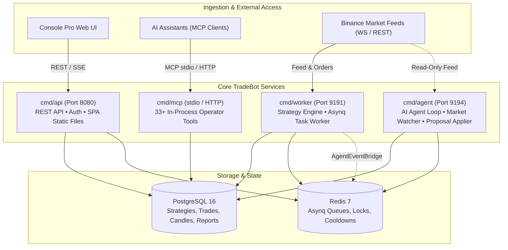

# System Architecture Overview

TradeBot is built upon a distributed, decoupled service architecture written in Go 1.25. Dependency injection is managed uniformly by **Uber FX**, ensuring that services share domain usecases and infrastructure libraries while remaining strictly isolated in their operational responsibilities.

---

## The Four Core Services

### 1. `cmd/api` (REST API & Web UI)
* **Port**: `8080`
* **Responsibilities**:
  * Serves the REST API (`gorilla/mux`) mounted strictly under the `/api` prefix.
  * Serves the embedded React Single Page Application (`cmd/api/webui/`, embedded via `go:embed`) with client-side SPA fallback.
  * Manages multi-user authentication, HttpOnly session cookies (`gtb_session`), CSRF tokens (`X-Requested-With: gtb`), and Cloudflare Access JWT validation.
  * Enforces role-based capabilities (`view`, `backtest`, `edit_drafts`, `agent_chat`, `approve_proposals`, `admin`).
  * Provides Server-Sent Events (SSE) streaming for real-time price and position updates (`GET /api/stream/dashboard`).

### 2. `cmd/worker` (Trading Engine & Task Processor)
* **Port**: `9191` (Hosts Asynqmon UI and `/metrics`)
* **Responsibilities**:
  * Asynq consumer serving the default queue for strategy cycle execution.
  * Evaluates the **Dual-Layer Mode Guard** (`MODE` vs. strategy `Mode`).
  * Executes Lua strategy cycles inside sandboxed `gopher-lua` runtimes.
  * Evaluates resting stops and enforces the **Daily Loss Limit (R-01)**.
  * Runs the **Candle Dataset Reconciler** worker to keep historical datasets synchronized without downtime.
  * Emits trade and risk events to external webhooks and via `AgentEventBridge` to the `agents` queue.

### 3. `cmd/agent` (Autonomous AI Runtime)
* **Port**: `9194` (Hosts Agent Asynqmon UI and `/metrics`)
* **Responsibilities**:
  * Consumes strictly from the `agents` Asynq queue (`agent:run`, `agent:apply_proposal`, `agent:sweep_events`).
  * Runs periodic cron schedules for active agent personas.
  * Hosts the 1-minute candle **Market Watcher** for volatility and price movement triggers.
  * **Strict Safety Boundary**: Injected exclusively with `exchange.ReadOnlyClient`. The agent runtime cannot place orders or alter exchange state.
  * Evaluates walk-forward deploy gates and applies approved proposals when champion strategies reach a flat state.

### 4. `cmd/mcp` (Model Context Protocol Server)
* **Transport**: stdio or HTTP (`--transport=http`)
* **Responsibilities**:
  * Exposes 33 operator tools directly to external AI assistants (Cursor, Claude Desktop, Antigravity).
  * Calls application usecases **in-process** without network hops or intermediate HTTP authentication overhead.
  * Strips sensitive credentials and URLs from tool responses to prevent token leakage.

---

## Dependency Structure & Clean Architecture

Dependencies flow inward following Clean Architecture principles:

$$\text{HTTP / MCP / Worker Handlers} \longrightarrow \text{Usecases} \longrightarrow \text{Repositories} \longrightarrow \text{Domain Entities}$$

* **`app/entities/`**: Domain entities mapped to GORM models (`Strategy`, `Signal`, `Order`, `Candle`, `BacktestRun`, `Agent`, `StrategyChangeProposal`).
* **`app/usecase/`**: Pure business logic with interface-driven dependencies, enabling fast, isolated unit testing.
* **`app/repository/`**: GORM-based persistence implementations for PostgreSQL and SQLite.
* **`internal/exchange/`**: Anti-Corruption Layer (ACL) for exchange connectivity (`BinanceAdapter`, `BinanceTestnetAdapter`, `ReadOnlyClient`, `DryRunExchange`). No external package imports `go-binance` directly.
