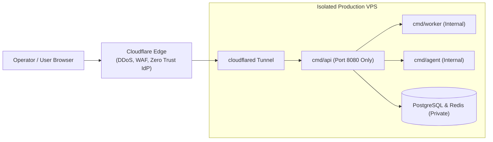

# Cloudflare Production Deployment & Multi-User Security

When operating a live trading system in production, exposing management interfaces or database ports to the public internet presents severe security risks.

TradeBot is designed to operate behind **Cloudflare Zero Trust** using `cloudflared` tunnels.

---

## 1. Zero-Trust Architecture



### Security Isolation Rules:
* **Only Port 8080 is Exposed**: Cloudflare Tunnel routes exclusively to `cmd/api`.
* **Zero Public Inbound Ports**: All firewall inbound ports on your VPS (including 80, 443, 5432, 6379, 9191, 9194) should be blocked.
* **Internal Communication Only**: `cmd/worker`, `cmd/agent`, PostgreSQL, and Redis communicate entirely over Docker private networks or localhost loopback interfaces.

---

## 2. Cloudflare Access JWT Integration

TradeBot can validate signed JWT tokens issued by Cloudflare Access before permitting requests to reach the application:

```yaml
cf_access:
  enabled: true
  team_domain: "your-team.cloudflareaccess.com"
  aud: "YOUR_CLOUDFLARE_APPLICATION_AUD_HEX"
```

When enabled:
* The backend verifies the `Cf-Access-Jwt-Assertion` header against Cloudflare's public keys (`/cdn-cgi/access/certs`).
* Bypassing Cloudflare Edge or submitting forged requests is rejected immediately with HTTP 401.

---

## 3. Multi-User RBAC & Capabilities

TradeBot features granular Role-Based Access Control:

### User Roles:
* **Admin**: Unrestricted control. Can manage users, alter global settings, edit live strategies, approve proposals, and access all agent features.
* **Friend**: Intended for co-operators. Can view all dashboards, run backtests, and draft backtest-mode strategies. Cannot alter live strategies or modify API credentials.
* **Viewer**: Read-only access to charts, open positions, closed trades, and performance reports.

### Per-User Capabilities:
| Capability | Permission Granted |
| :--- | :--- |
| `view` | View dashboard, strategies, positions, and performance reports. |
| `backtest` | Launch backtests, walk-forward runs, and view simulation results. |
| `edit_drafts` | Create and edit `backtest`-mode strategy drafts. |
| `agent_chat` | Interact with the AI copilot chat interface. |
| `approve_proposals`| Approve or reject strategy change proposals for live deployment. |
| `admin` | Manage user accounts, system configuration, and live/productive strategies. |

---

## 4. User Budget Caps & Per-User Transcripts

* **Chat Budgets**: Each user has an individual daily spending limit (`UserUsage`). When exceeded, the chat returns HTTP 409 (`user_budget_exceeded`), preventing runaway LLM billing.
* **Isolated Transcripts**: Users maintain private, isolated chat histories (`mine=true`), preventing co-workers from overwriting each other's prompts and sessions.
