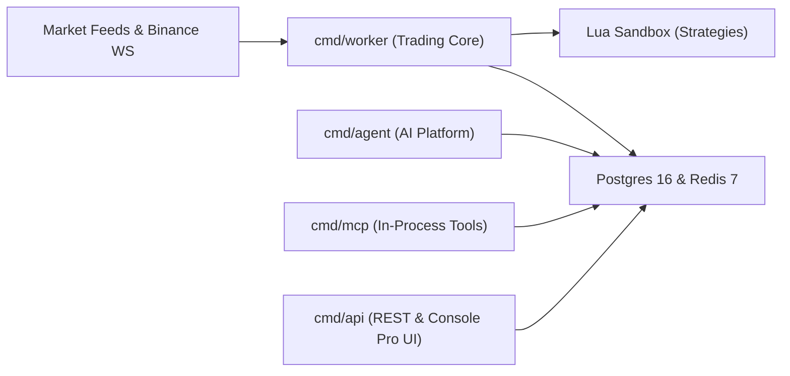

# Go Binance Trade Bot Documentation

Welcome to the official documentation for **Go Binance Trade Bot**, an institutional-grade, distributed algorithmic trading platform and autonomous AI strategy co-pilot for Binance spot markets.

---

## What is Go Binance Trade Bot?

TradeBot is built in Go to provide quantitative traders and engineering teams with a robust, production-hardened platform for executing automated strategies. Rather than relying on simple scripts or monolithic trading bots, TradeBot separates concerns across decoupled microservices, sandboxed execution runtimes, and autonomous AI agents:

---

## Core Pillars

### 1. Dual-Layer Safety & Capital Protection
Trading bots execute real orders with real money. TradeBot is architected with non-negotiable safety boundaries:
- **Dual-Layer Mode Guard**: The strategy `Mode` and process-level `MODE` must both agree before any order is submitted to live markets. Live execution also requires `CONFIRM_LIVE=true` and `Testnet=false`.
- **Exchange-Side Stop Losses**: Positions immediately submit native exchange `STOP_MARKET` orders upon fill—never relying solely on local polling.
- **Daily Loss Limits (R-01)**: Strategies halt new entries the instant realized daily losses (since 00:00 UTC) hit the defined limit.
- **Read-Only AI Sandbox**: The AI runtime (`cmd/agent`) is compiled exclusively with a read-only exchange adapter.

### 2. High-Performance Lua Strategy Sandbox
Every strategy is authored in standard Lua, executed within an isolated `gopher-lua` VM:
- **TA-Lib Integration**: Access 60+ technical indicators directly through the `ind.*` namespace (`ind.rsi`, `ind.bollinger`, `ind.macd`, `ind.atr`, etc.).
- **State Persistence**: Persist cross-cycle variables safely across worker replicas via `state.*`.
- **Execution Tracing**: Detailed step-by-step trace records captured per candle for debugging and historical analysis.

### 3. Autonomous AI Agents & Deploy Gate
TradeBot features an autonomous multi-persona AI agent platform powered by Claude and Gemini:
- **Event & Volatility Triggers**: Agents activate automatically on stop-loss hits, drawdowns, market volatility spikes, or cron schedules.
- **Challengers & Deploy Gate**: Proposed improvements are forked into paper-trading **challengers**. They must pass automated walk-forward Sharpe/Drawdown gates before being submitted to the human operator for approval.

### 4. Native Model Context Protocol (MCP) Server
An in-process MCP server exposes 33 operator tools directly to AI coding assistants like Claude Desktop, Cursor, and Antigravity—enabling ad-hoc backtests, REPL runs, coverage checks, and performance reviews.

---

## Documentation Navigation

| Section | Description |
| :--- | :--- |
| **[Architecture](architecture/overview.md)** | Deep dive into the 4-binary architecture, safety invariants, and data pipeline. |
| **[Trading Engine](trading/execution-modes.md)** | Learn about Live/Paper/Dry-run/Backtest modes, Lua scripting, and risk controls. |
| **[Agents Platform](agents/platform.md)** | Understand agent personas, triggers, walk-forward deploy gates, and MCP tools. |
| **[Deployment & Guides](guides/quickstart-docker.md)** | Step-by-step Docker Compose deployment, local dev setup, and Cloudflare Zero Trust. |
| **[API & Observability](api/rest-reference.md)** | REST endpoints, WebSocket/SSE feeds, Prometheus metrics, and Grafana dashboards. |
