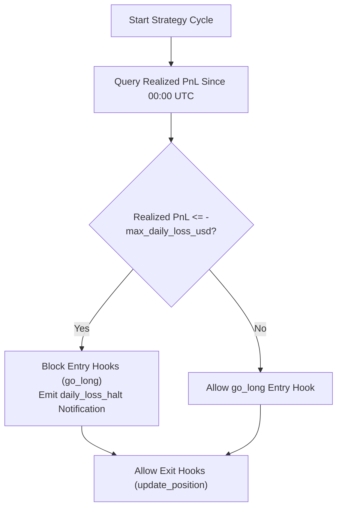

# Risk Management & Capital Controls

Capital preservation is the highest priority in automated trading. TradeBot implements deterministic risk checks across every phase of order execution.

---

## 1. Daily Loss Limit per Strategy (R-01)

The Daily Loss Limit prevents runaway drawdowns in erratic market regimes.



### Key Invariants:
* **Stateless Tracking**: Evaluated dynamically by summing the `Profit` column of orders closed since 00:00 UTC of the active candle. No error-prone in-memory state.
* **Exits Remain Operational**: Existing positions are never blocked from exiting.
* **Single Daily Notification**: Emits an alert to configured notification webhooks when the threshold is first breached.
* **Fail-Closed**: If the database query for closed orders fails, the strategy cycle errors and blocks new entries.

---

## 2. Order Sizing Clamping (B-03)

In addition to system-level sizing parameters, Lua scripts can request specific order sizes via `qty`:

```lua
return {
    action = "buy",
    qty = 0.05 -- Requested size
}
```

### Safety Clamping:
To prevent rogue scripts or calculation overflows from placing excessive orders:
* The Go engine evaluates the requested `qty` against the strategy's allocated risk ceiling and available quote asset balance.
* If `qty` exceeds the risk limit, the order is **safely clamped down** to the maximum permitted position size.
* The clamped quantity is recorded in the cycle execution trace log for complete auditability.

---

## 3. Order Exits & Reason Tracking

Every closed trade in TradeBot records an unambiguous `ExitReason` in the `orders` table:

| Exit Reason | Trigger Mechanism | Enforced By |
| :--- | :--- | :--- |
| `stop_loss` | Stop price breached | Binance Exchange matching engine (`STOP_MARKET`) |
| `simulated_stop_loss` | Low price breached in dryrun | Worker `engine.SimulatedStopEvaluator` |
| `take_profit` | Price reached target `TakeProfitPrice` | TradeBot Engine cycle check |
| `strategy_exit` | Script returned `{action = "sell"}` | Lua `update_position` hook |
| `manual` | Operator closed position via API/UI | `POST /api/signal/close/{id}` |

---

## 4. Panic Recovery & Webhook Alerts

If a Lua script triggers an unexpected runtime error (e.g., attempting arithmetic on a nil value), or an indicator encounters unexpected input:
* The engine catches the panic per cycle via deferred recovery.
* Increments the Prometheus metric `strategy_panics_total{strategy="..."}`.
* Dispatches a high-priority alert to configured Discord, Slack, Telegram, or custom webhooks.
* Skips order placement for that cycle without taking down the worker process.
